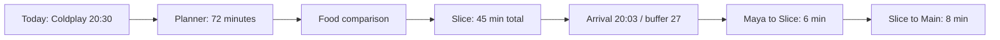
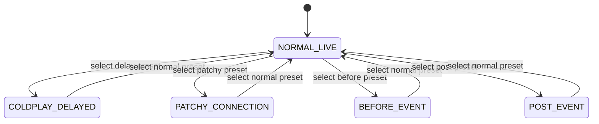
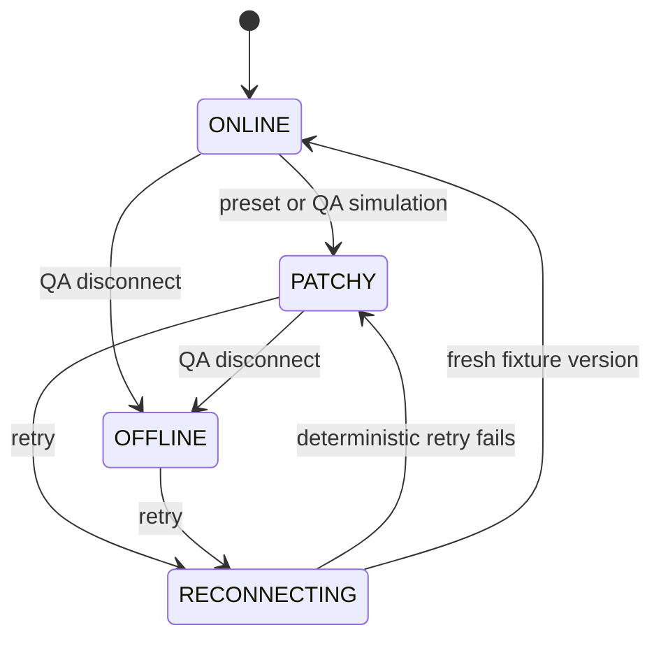
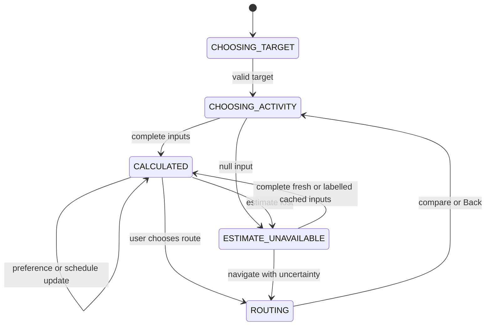
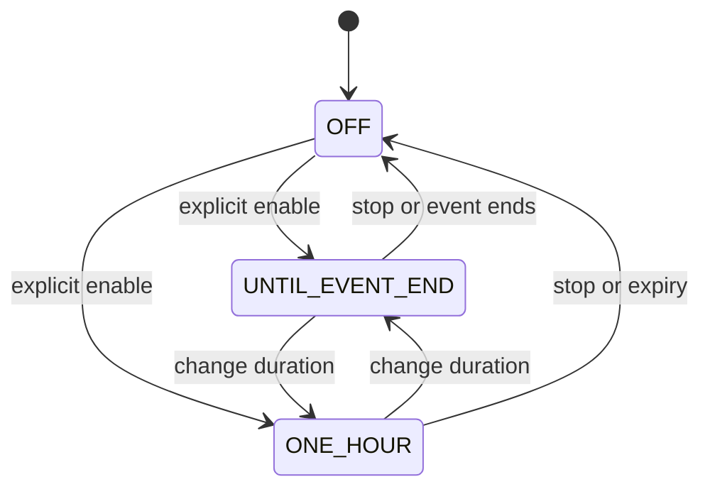

# QUEUE — UX flows and state transitions

Authority: **03 → 02 → 08 → 04 → 05 → 06 → 07 → 01**. Numerical examples below assume NORMAL_LIVE, 19:18, FASTEST and Coldplay target unless stated otherwise. URLs are the final contract in 04. Flows must use fixture selectors; changing target, route preference or schedule version recomputes the consequence.

## Common interaction contract

Buttons announce the action and resulting destination. Every detail screen has a clear parent/back exit. Preserve state on navigation. A calculation is transparent and advisory; never block a route due to tight timing. Missing durations remain unknown. Cached estimates remain labelled stale in comparisons and results. No side effect sends a real message, orders food, charges money or shares real GPS.

Save adds a performance to Saved; Must See adds it to both sets. Remove Must See leaves it Saved. Unsave removes both. Target selection chooses the earliest remaining Must See on the current demo day, then Saved, otherwise no target. Explicit planner targets can override selection locally but must be named throughout the scenario. Do not claim a set remains Must See after removal.

## Flow 1 — Landing → Demo → Today

- **Entry / intent:** `/`; reviewer wants immediate understanding and no account requirement.
- **Steps:** read promise and illustrative composition; select Enter demo; `/demo` establishes/resumes the local session and replaces URL with `/today`.
- **System / calculation:** show Coldplay at 20:30, 72 minutes, eight-minute walk, leave 20:18; now Arctic Monkeys, 17 minutes remaining. First entry already selects Coldplay Must See and saves Fred.
- **State changes:** initialize defaults only for a new/invalid session; mark demo session entered. No credentials and no forced setup.
- **Success / alternative:** useful Today in one action; preview/setup available separately.
- **Error / exit:** local storage failure uses in-memory state and a brief persistence notice, not a gate. Exit via primary navigation or QUEUE home.

## Flow 2 — Signup → Setup → Must See → Today

- **Entry / intent:** `/signup`; build a personal demonstration day.
- **Steps:** name, email, password (minimum six characters) → local submit → `/setup` → select Coldplay/Fred → Build my day → Today. Login uses email/password and the same local continuation.
- **System / calculation:** native plus accessible inline form validation; password visibility toggle; event/date/Pune/Weekend Pass; Coldplay checked by default. Selected priorities feed the next-target selector.
- **State changes:** store display name, onboarding completion and selected IDs only; never store/log the password or assert server authentication.
- **Success / alternative:** Today reflects selections. Explore demo skips forms. No selected priority gives a useful schedule CTA, not a hidden Coldplay priority.
- **Error / exit:** invalid email/missing name/short password gets field-specific text; focus first error on submit. Cancel goes to landing; setup can be revisited from account.

## Flow 3 — Signature food decision

- **Entry / intent:** Today → What can I do before?; wants food without missing Coldplay.
- **Steps:** `/decision?target=coldplay` → Grab food → `/food` → Slice Club → `/food/slice-club?target=coldplay` → inspect result → Route me there → `/route?from=maya-zone&to=slice-club`; after arrival explicitly Continue to Main Stage changes to `/route?from=slice-club&to=main-stage`.
- **System / calculation:** planner shows 72 minutes and complete activity totals. Slice result presents “Yes — with room,” 6 + 4 + 7 + 20 + 8 = 45; arrival 20:03, target 20:30, buffer 27. All timeline values are accessible immediately; motion only emphasizes them.
- **State changes:** decisionScenario stores activity/target; route selection saves endpoint/profile identity. Start walking changes local route status, not physical location automatically.
- **Success / alternative:** understand the consequence and both route legs; compare Taco (55/20:13/17), Bombay (47/20:05/25), Green (49/20:07/23). Preference changes recalculate supported legs.
- **Error / exit:** stale queue warning preserves a cached example; null queue shows “Queue estimate unavailable” and no confident total. Route remains usable. Compare returns to Food retaining filter; Back returns to planner.

## Flow 4 — Restroom quick action

- **Entry / intent:** Today or Live → WC; needs a practical immediate option.
- **Steps:** `/restrooms` → nearest Restroom B → Take me there → route to restroom-b.
- **System / calculation:** 3-minute walk, 2-minute wait, LOW crowd, accessible facilities; alternative A is 5-minute walk, 7-minute wait, MODERATE. Planner total B is 3 + 2 + 2 use + 4 onward = 11, arrival 19:29, buffer 61.
- **State changes:** selected POI and active route; do not auto-mark a facility visited.
- **Success / alternative:** nearest useful option visible without scrolling; choose A via its map/detail.
- **Error / exit:** unknown wait is labelled unavailable and distance remains; stale waits carry age. Return to Today/Live or Map.

## Flow 5 — Water → Add to existing route

- **Entry / intent:** quick action or active route; refill with minimal detour.
- **Steps:** `/water` → Water 2 → Add to route. If no active route, create Maya → Water 2 tap → Main Stage with target confirmation. If active route already passes the tap, add a refill activity without a duplicate waypoint.
- **System / calculation:** 2-minute access, no meaningful wait, 2-minute refill, 4-minute onward; standalone total 8. Existing route total is recomputed from its explicit segments plus two-minute refill, not by adding the standalone eight minutes. A Slice → Main template already passes Water 2: adding refill makes onward 10 and food total 47, arrival 20:05, buffer 25.
- **State changes:** activeRoute.waypoints adds water-2-tap and activityMinutes 2 once. Removing it restores prior values.
- **Success / alternative:** “You're already passing Water 2” when appropriate; Water 1 alternative remains available.
- **Error / exit:** unavailable alternate geometry retains original route and offers a separate Water route. Cancel leaves route intact; Back to original route/Today.

## Flow 6 — Schedule → Coldplay → Must See synchronization

- **Entry / intent:** `/schedule`; choose a priority.
- **Steps:** Coldplay detail `/schedule/coldplay`; toggle Must See; return Today/Live.
- **System / calculation:** countdown/leave use effective start and active origin route; normal 72/20:18, delayed 92/20:38. Save and priority states are reflected everywhere.
- **State changes:** Must See adds Saved; removal only removes priority. Unsave removes both and invalidates an implicit target. Explicit scenario retains a target but labels it unprioritized.
- **Success / alternative:** next target selector updates atomically; if no Must See but Fred Saved, show Fred as Next Saved Set.
- **Error / exit:** unknown ID offers Schedule; no remaining target offers Choose a set. Back preserves day/filter and scroll.

## Flow 7 — Schedule conflict and transfer check

- **Entry / intent:** user saves multiple sets; understand overlap and travel.
- **Steps:** save Arctic Monkeys and Glass Animals → conflict banner; save Glass Animals and Coldplay → transfer check; delayed Coldplay + Fred → overlap plus travel advisory.
- **System / calculation:** Arctic/Glass overlap 19:15–19:35, 20 min. Glass ends 20:00 → Main 14 min → Coldplay 20:30, buffer 16 (36 delayed): not an overlap. Normal Coldplay ends 22:00, Fred 22:15, travel 12, buffer 3; four-minute arrival preference requires leaving at 21:59. Delayed Coldplay ends 22:20, overlapping Fred by 5 minutes.
- **State changes:** derived advisory only; no automatic unsave or schedule mutation.
- **Success / alternative:** user chooses which set to prioritize or leaves one early; both can remain saved.
- **Error / exit:** unknown transfer means timing unavailable, not no conflict; remove a save or open either detail; return to list.

## Flow 8 — Live Mode

- **Entry / intent:** Today → `/live`; one-glance information while moving.
- **Steps:** read Now, Next, countdown and Leave; choose Food/Water/WC/Friends or planner; Exit Live returns Today.
- **System / calculation:** Arctic Monkeys/River/17 min; Coldplay/Main/20:30/72 min/leave 20:18. Same target selector as Today. Saved fallback and empty target states remain clear. Before/post presets show phase-appropriate entry/exit content instead of stale live countdowns.
- **State changes:** view mode only. Returning from a utility can restore Live as originating view.
- **Success / alternative:** important answer in roughly two seconds; no form-heavy submenu.
- **Error / exit:** offline notice stays brief but explicit, cached estimates accessible in detail; no aggressive flashing. Exit control always visible and keyboard reachable.

## Flow 9 — Map → POI → Route

- **Entry / intent:** `/map`; relate place, time and conditions.
- **Steps:** select marker or text-list item → `/venues/:poiId`; inspect walk/crowd/accessibility → Navigate → route with explicit origin/destination.
- **System / calculation:** mobile nonmodal collapsed sheet, desktop side panel; same selection/facts. Highlight marker and route from 08. Selection does not imply movement.
- **State changes:** selectedPOIId then activeRoute; URL persists endpoint identity.
- **Success / alternative:** selected POI retains context on the visible map; layers and text alternative can select the same place.
- **Error / exit:** unknown POI or unsupported route gives useful list/signage guidance, not Main Stage fallback. Close sheet returns Map; Back preserves zoom/layer.

## Flow 10 — Route preference switch

- **Entry / intent:** route detail; balance speed, crowd and step-free access.
- **Steps:** choose FASTEST, LESS_CROWDED or STEP_FREE with radio controls.
- **System / calculation:** Slice → Main 8/MODERATE, 10/LOW, 11/LOW. Update geometry, instructions, duration and dependent decision together. Slice total becomes 45, 47, 48 and buffers 27, 25, 24; direct Maya → Main leave becomes 20:18, 20:16, 20:15.
- **State changes:** shared routePreference; update route template and derived selectors. No fixed global +2/+3 for unrelated routes.
- **Success / alternative:** same available route for unsupported alternate distinctions is explicitly stated; not fabricated.
- **Error / exit:** missing profile path keeps previously valid route and announces unavailability. Back returns destination/result retaining preference.

## Flow 11 — Friends → Rohan → Meet Rohan

- **Entry / intent:** `/friends`; catch up before the priority set.
- **Steps:** select Rohan → `/friends/rohan` → Meet Rohan → route maya-zone to rohan-zone → onward route main-stage when ready.
- **System / calculation:** zone near Food Court A; 6 walk + 5 meet/buffer + 9 onward = 20; arrival 19:38; normal buffer 52; “You have time.” No continuous precise tracking.
- **State changes:** selected friend and decision scenario; confirming sets simulated heading status without enabling sharing silently.
- **Success / alternative:** meetup fits visibly; group Water 2 option available.
- **Error / exit:** stale zone is labelled 19:16; paused/unknown zone cannot give a current confidence claim. Offer group point or last-known zone with confirmation. Return Friends.

## Flow 12 — Group meetup at Water 2

- **Entry / intent:** Friends → Meet the group.
- **Steps:** `/friends/group` shows point and reasons; “I'm heading there” updates local status; route to water-2-meet.
- **System / calculation:** central, LOW crowd, toward Main; Maya 4, Rohan 6, Aanya 5 minutes. Latest arrival 19:24; the 2-minute refill access is a different endpoint. No invented full group chat or automatic movement.
- **State changes:** Maya heading destination water-2-meet; sharing stays as chosen.
- **Success / alternative:** practical point understood; choose Water detail or Map.
- **Error / exit:** stale friend ETAs labelled cached; no exact all-present status implied. Cancel heading or return Friends.

## Flow 13 — Location sharing

- **Entry / intent:** Friends/account controls; share only useful zone information.
- **Steps:** default OFF → choose Until event ends or For 1 hour → explicit enable; Stop sharing available in the same control.
- **System / calculation:** privacy copy: “Friends can see your approximate festival zone, not a precise GPS trail.” One hour at 19:18 expires 20:18; event-end expires Sunday 21:00. Check expiration on deterministic time changes.
- **State changes:** mode, expiresAt, approximate outward zone; stop clears outward zone immediately. Consent to share is independent of displaying consented friend fixtures.
- **Success / alternative:** current mode visibly named; no OS geolocation needed for simulated zones.
- **Error / exit:** storage failure uses transient controls with notice. Patchy state cannot imply recently delivered sharing. Exit preserves explicit mode, not hidden background tracking.

## Flow 14 — Coldplay delay

- **Entry / intent:** account/demo menu selects COLDPLAY_DELAYED; understand a changing event.
- **Steps:** apply shared schedule version → banner → See what fits or Dismiss.
- **System / calculation:** start 20:30 → 20:50; end 22:00 → 22:20; leave 20:18 → 20:38; countdown 72 → 92; Slice arrival 20:03 unchanged, buffer 27 → 47. Copy “Coldplay's updated start time gives you 20 more minutes.” Fred overlap is derived honestly.
- **State changes:** eventState, scheduleChanges, version; all selectors update before visual emphasis. Dismiss stores notification version only.
- **Success / alternative:** Today/Live/Schedule/detail/planner/result show one consistent effective start; Normal reverses the preset.
- **Error / exit:** during refresh use last-known schedule visibly labelled; never a mix of old/new calculations. Banner dismissal retains updated data; close menu returns focus.

## Flow 15 — Patchy connection

- **Entry / intent:** menu selects PATCHY_CONNECTION; continue with essentials.
- **Steps:** banner → saved schedule/map/routes/pass remain → live estimates display timestamps → Retry.
- **System / calculation:** current 19:18, last update 19:16, age 2 min. “Connection is patchy. Your saved schedule and festival map are still available.” Cached food calculation is illustrative, not a fresh guarantee.
- **State changes:** network PATCHY; estimates STALE; static geometry/pass/schedule unchanged. Preset is baseline normal schedule; orthogonal offline QA retains whichever schedule was last known.
- **Success / alternative:** useful cached content accessible; retry remains patchy in this deterministic preset. Menu Normal restores FRESH atomically.
- **Error / exit:** queue null: distance/route remain, result unknown. Crowd null: “Crowd estimate unavailable.” Friend null: paused/unavailable zone. Never substitute 0 or hide freshness. Return through any primary tab.

## Flow 16 — Before event

- **Entry / intent:** menu BEFORE_EVENT; prepare ahead.
- **Steps:** Today at Sat 14:00 → Saturday starts in 3h → saved artists/Gate 2/entry essentials/download map → View my day.
- **System / calculation:** opening 17:00; gate 16:00; no “happening now” stage cards. Map and schedule are preview estimates, not live conditions.
- **State changes:** currentDemoTime 840 and phase BEFORE; chosen priorities retained. Reset Normal restores 1158.
- **Success / alternative:** plan and cache essentials; preview/setup accessible.
- **Error / exit:** download unavailable offers text map/manual reference; no false offline-ready claim. Exit via schedule or scenario menu.

## Flow 17 — Post event

- **Entry / intent:** menu POST_EVENT; close out without gamification.
- **Steps:** Today Sun 21:30 → “That's a wrap.” → illustrative 5 performances/2 stages/1 meetup → saved schedule → optional feedback Yes/Somewhat/No.
- **System / calculation:** fixed demo recap, not observed attendance; past sets are historical, no next live target. Sharing expired at Sunday 21:00.
- **State changes:** phase POST, sharing OFF, optional local feedback selection. No points/rewards.
- **Success / alternative:** simple closure and past schedule reference.
- **Error / exit:** persistence failure acknowledged; feedback does not block navigation. Live link shows phase-aware exit; scenario switch returns live demo.

## Flow 18 — Search

- **Entry / intent:** header or Map search; find an artist/place/service.
- **Steps:** `/search` → type → categorized results → select destination.
- **System / calculation:** case-insensitive substring plus aliases (pizza → Slice Club, WC → restrooms, first aid → Medical). “pizza” shows Slice/6 walk/4 queue; “Coldplay” shows effective 20:30 or 20:50/Main. No remote search required.
- **State changes:** query in URL replaceState; no schedule mutation. Modal closes on selection; direct URL works as page.
- **Success / alternative:** result routes to correct detail; utility aliases may show best practical option and alternatives.
- **Error / exit:** no results: keep query, suggest stages/food/facilities, Clear action. Escape/Close returns origin with focus; direct-load exit Today.

## Flow 19 — Medical

- **Entry / intent:** Today secondary action, search or pass; find help immediately.
- **Steps:** `/medical` → nearest Medical Point, 4-minute walk → Navigate; emergency info inline.
- **System / calculation:** no queue recommendation, food-style comparison or decorative motion. Instructions direct to festival staff; emergency number 112 is a static India-context reference from 03, not a calling integration. It is confirmed by the [Government of India ERSS reference](https://112.gov.in/); no venue partnership or response-time guarantee is implied.
- **State changes:** selected POI and route only; no medical profile or health data.
- **Success / alternative:** primary action visible first; ask a steward if route unavailable.
- **Error / exit:** map unavailable leaves text directions and staffed-help guidance. Back or Pass/Today exit always remains.

## Flow 20 — Accessible / low-sensory route

- **Entry / intent:** Map layers or route preference; choose practical comfort/access.
- **Steps:** Accessibility shows accessible restroom/viewing and step-free paths; Low sensory shows Quiet Zone, Water, Medical and less-crowded paths; select POI → choose route.
- **System / calculation:** labels and text describe simulated conditions. Slice STEP_FREE 11 minutes; LOW crowd; no stairs indicated in fixture; not a real-world guarantee. Quiet Zone five-minute origin walk.
- **State changes:** layer/preference/selection; do not infer or store a user's disability.
- **Success / alternative:** text map contains same metadata; keyboard-only route selection works.
- **Error / exit:** unavailable accessibility route names the limitation and retains signage/staff guidance. Clear layer does not discard selection; exit to Map/Today.

## State machines

Five presenter presets select orthogonal phase/schedule/network combinations as documented in 03; they are not an irreversible chronological timer.

The account selector can move directly between any preset; reset restores complete defaults. Above arrows illustrate common demonstrations, not restricted reachability.

CALCULATED has derived WITH_ROOM/WITHIN_PLAN/TIGHT/CONFLICT substates. They are not separately stored.

Friend activity state (Available/Heading somewhere/At stage/Location paused) is distinct from Maya's sharing mode and network freshness. Never use an “online” social-status dot as proof of physical location.

User-requested calendar extension: app header offers a compact October 2026 dropdown. Only the canonical festival days, 17 and 18 October, are selectable; each displays effective performance times with detail links and a full-schedule exit. Escape/outside click closes it. It does not invent additional events or alter the demo clock.

User-requested invitation extension: Friends contains a named invitation form and optional inclusion of Saved performances. Create generates a versioned plan-snapshot URL; Copy uses the clipboard with a selectable-field fallback. Invitations persist locally and can be removed locally. `/friends/join?plan=` validates the snapshot, previews its performances and explicitly adds them to Saved only on acceptance. This does not enable location sharing, send messages or imply real-time collaboration. The localhost preview clearly explains that publishing is needed for other-device access.
