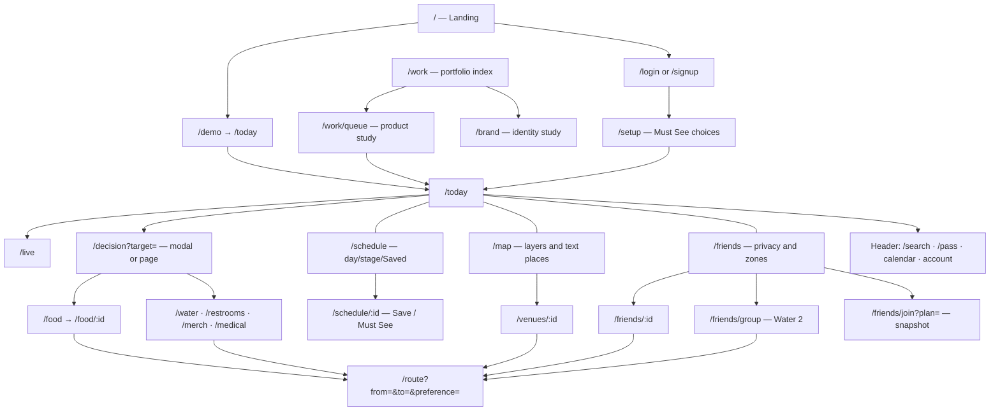

# QUEUE — implemented information architecture

Source: src/main.js router and navigation; src/views.js, public-views.js, social-calendar.js. Public portfolio routes added separately from the application. This is a navigation hierarchy, not a backend architecture.

Today = immediate decision context. Schedule = temporal plan. Map = spatial plan. Friends = social context and privacy. Essentials are reachable from the current task rather than an unrelated marketplace. Search, Pass, Calendar and Account remain supporting entry points. Live is a reduced-density view of the same plan.

State is shared through model selectors/local persistence, not duplicated per navigation section. Deep links retain target, filters, route endpoints and preferences. Invalid IDs, unsupported routes and no-target states expose recovery.
