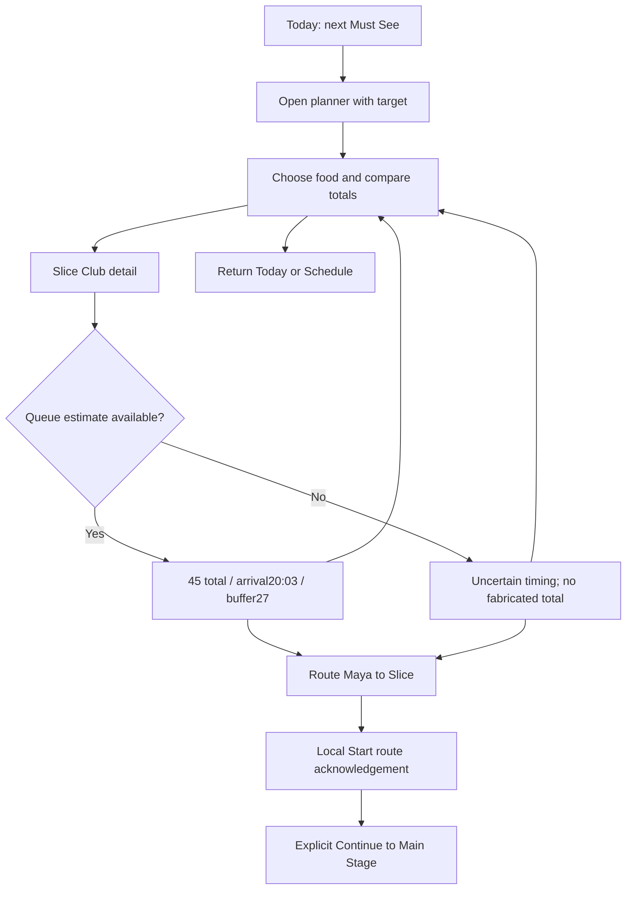
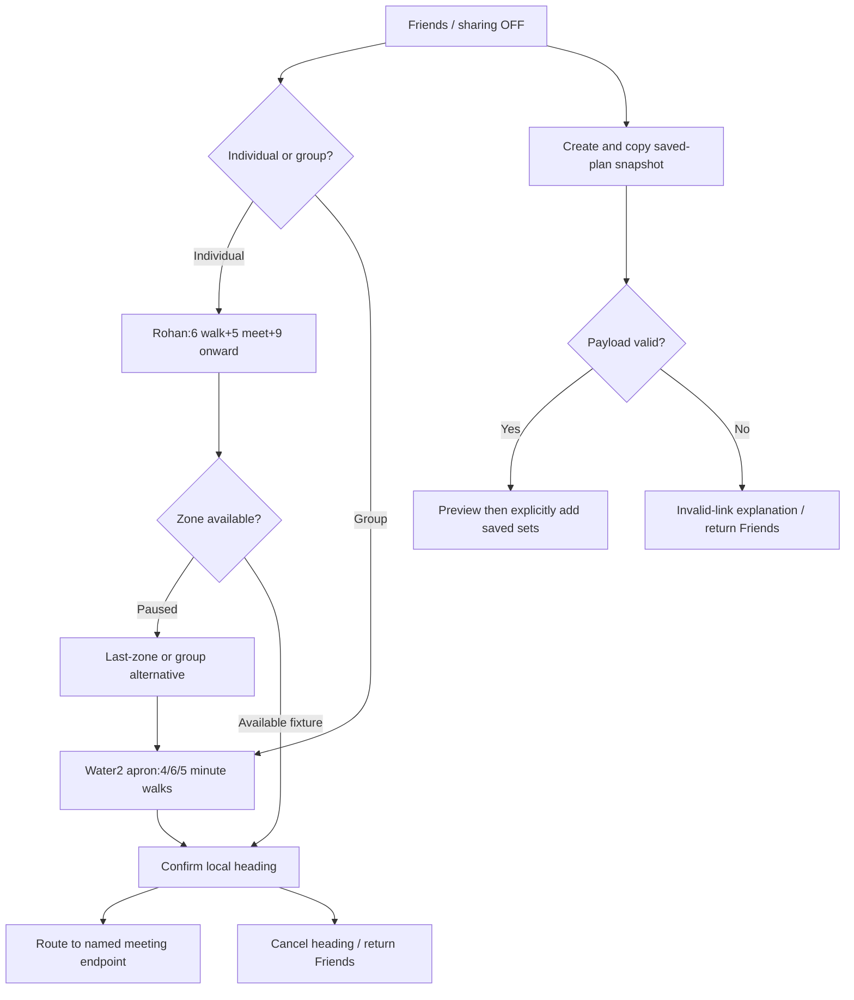
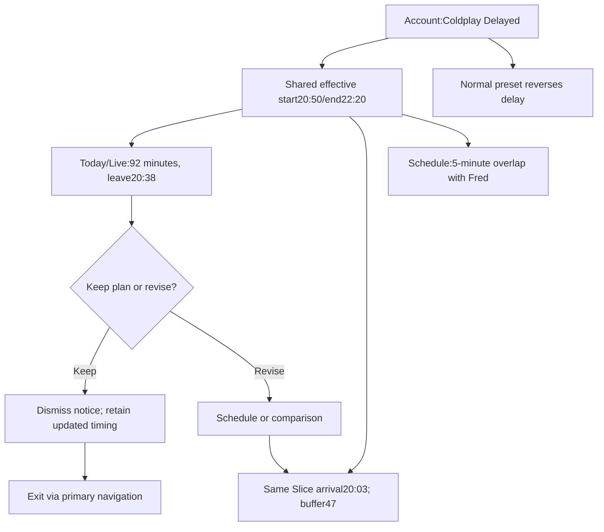

# QUEUE — primary flows

Implemented unless explicitly labelled proposed. Fixed normal fixture: 19:18, target Coldplay at20:30, fastest route. Sources src/main.js, views.js, model.js and social-calendar.js.

## A — food before the next priority

Validation: route parameters map to supported templates; queue null invalidates complete timing; all five step durations contribute to arrival. Save/start acknowledge local state only. No physical arrival or food order is tracked. Success = inspect consequence and choose route; participant comprehension remains unvalidated.

## B — private meetup coordination

Sharing stays OFF unless explicitly enabled. Invitation acceptance merges performance IDs without enabling location. No email, real-time sync or delivery confirmation. Group apron is a different endpoint from the two-minute refill tap.

## C — changed schedule with recovery

Patchy is a separate preset: cached values show 19:16 freshness; queue unavailable is an independent control. A missing estimate cannot produce a confident number. Current code dismisses the delay banner independently from schedule state.

## Proposed validation

Observe whether participants can explain the total, select appropriate exit/recovery actions, distinguish old/missing values, and meet without enabling sharing. Model/browser assertions do not establish success with real attendees.
