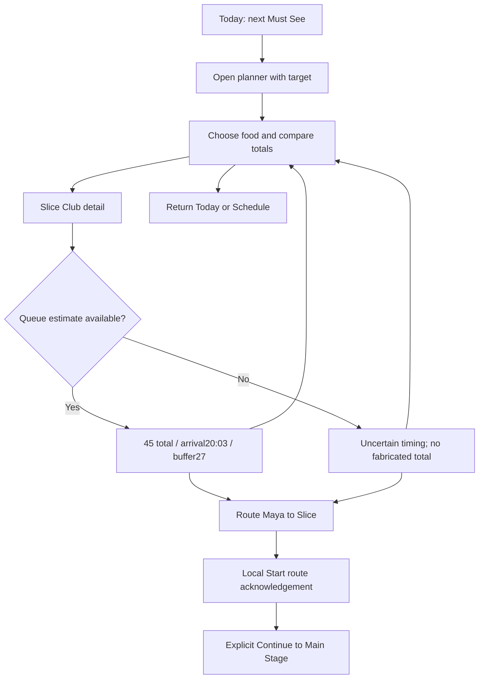
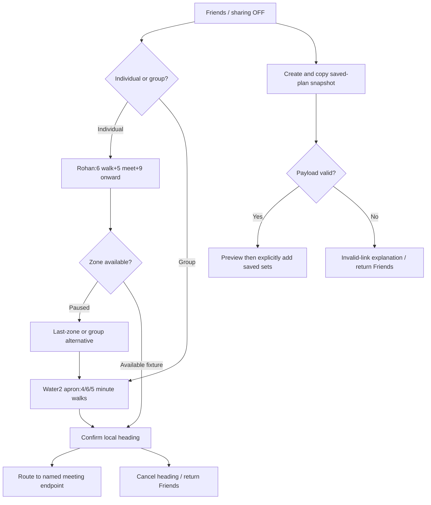
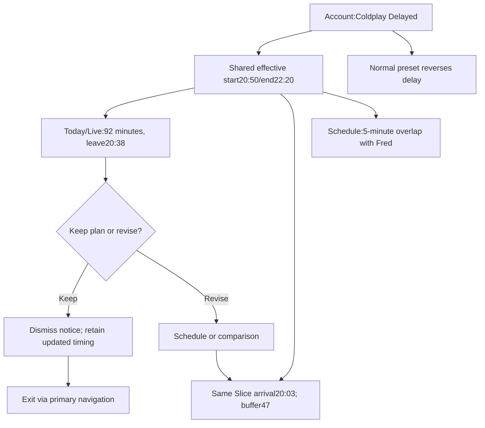
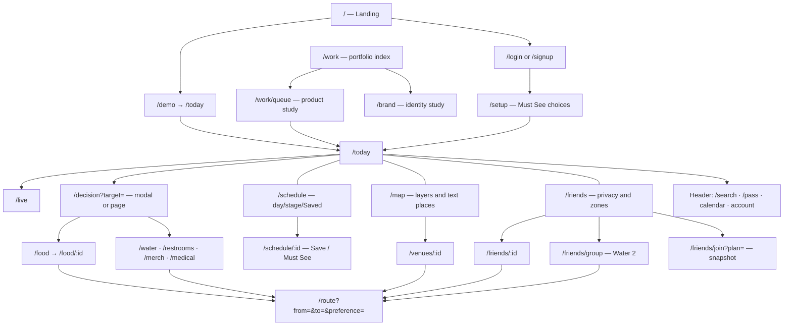

# QUEUE — product audit

Audit: 18 October 2026. Owner: Mitali Giri. Evidence: current source, eight canonical documents, repository commits, fresh Playwright/Edge captures, automated checks. This is a self-initiated responsive web concept for a fictional festival, not a virtual queue-management product.

## Actual product

QUEUE connects a saved performance to practical activity timing and wayfinding. Its signature question is whether an attendee can do an activity and still reach the next set. NORMAL_LIVE freezes Saturday 17 October 2026 at 19:18: Coldplay begins 20:30; suggested leave 20:18. Slice Club totals 6 walking + 4 waiting + 7 preparation + 20 eating + 8 onward = 45 minutes. Arrival 20:03, breathing room 27 minutes. The delayed fixture starts 20:50 and changes buffer to 47 while arrival stays constant.

Primary intended user: an attendee navigating between sets. Secondary contexts: friends arranging a meetup; someone seeking step-free, lower-crowd or low-sensory options. Maya is a provisional fixture persona, not a recruited research participant.

## Repository reviewed

README.md; IMPLEMENTATION.md; docs/01–08; package.json and lockfile; vercel.json; scripts/build.mjs and fonts.mjs; src/model.js, model.test.js, map-data.js, map.js, views.js, public-views.js, ui.js, main.js, motion.js, social-calendar.js, brand-identity.js, brand-page.js and style.css; public brand/font assets and licenses; tests/*.mjs; Git history. Generated node_modules/dist/cache are build artifacts, not design evidence.

Earlier implementation notes include superseded palette/layout descriptions. Current source and fresh captures take priority for visual evidence. In particular: cloud replaces warm cream; the mobile navigation is a floating pill; phone map details now flow below the canvas; touch swipes scroll the page and Ctrl+wheel zooms.

## Screen inventory

| Route | Implemented purpose / evidence status |
|---|---|
| / | Compact landing, demo entry, three feature links, attribution. Source and browser. |
| /login, /signup | Labelled local demonstration forms, native validation, reveal password. No backend/auth credentials stored. |
| /demo | Resumes default/local session at Today; no login required. |
| /setup, /preview | Select Must See performances; local onboarding. |
| /today | Priority/countdown/leave; now; essentials; saved sets; map. Browser capture. |
| /live | Reduced-density dark current/next context. Browser capture. |
| /schedule | Two days, stage/Saved filters; chronological phone list; desktop time grid; conflict/transfer notices. Browser capture. |
| /schedule/:id | Performance details, Save/Must See, walk/leave, conditions. |
| /decision?target= | Complete activity comparisons; page or URL-backed modal. |
| /food | Complete timing comparison with dietary/price filters. Browser capture. |
| /food/:id | Transparent timing, target arrival, buffer and routing. Browser capture. |
| /merch, /merch/kiosk | Tight main-merch timing and alternatives. |
| /restrooms, /water, /medical | Essential services; compare relevant facts; route/refill/staffed help. |
| /map | Layers, POIs, zoom/pan, recenter, selected labels and text list. Browser capture. |
| /venues/:id | POI selection and metadata in map context. |
| /route?from=&to=&preference= | Named route instructions, preferences, local start/save/refill. Browser capture. |
| /friends | Sharing controls, zones, local invitations. Browser capture. |
| /friends/group | Water 2 meeting apron with 4/6/5-minute fixture arrivals. Browser capture. |
| /friends/:id | Individual meetup timing or paused-zone recovery. |
| /friends/join?plan= | Validated snapshot preview/acceptance; sharing remains independent. |
| /pass | Decorative demo pass, Gate 2 and useful information; invalid for admission. Browser capture. |
| /search?q= | Local categorized results, aliases and retained-query no-results; modal or page. |
| /brand | Six Q explorations, comparative design judgments, final SVG logo system. |
| /work, /work/queue | Added portfolio index and isolated product case study. |

Unknown IDs and unsupported routes produce explicit recovery states, not fabricated destination data.

## State and implementation

Vite + modular vanilla JavaScript. Shared deterministic selectors own timing; versioned local storage persists saved sets, priorities, routes, sharing choices, heading intent, invitations and demo settings. 22 POIs, 38 nodes and 34 route templates. Five presets: Normal, Delayed, Patchy, Before, Post. No remote data API, real GPS, real message delivery, server authentication, ordering or payment. Invite URLs share snapshots, not synchronized collaboration. Offline service worker precaches shell/assets/fonts after a successful production load; new case-study screenshots are not guaranteed offline until fetched.

## Extracted system

Product: plum #20152E; cloud #F5F6FA; mint #A9EAD2; apricot #FF8B60; River #A9B8F4; Echo #CCB0EC. Brand communications: #191919/#F6F5F0/#D9F36B. Inter for UI; Space Grotesk structure/numbers; Impact and Georgia for expressive use. Original modular Q and vector wordmark. Native SVG outline icons/doodles. Typical 24px mobile gutters, 44px minimum target specification, 52–54px primary controls, finite transitions and reduced-motion overrides. Accumulated CSS overrides are a maintenance risk.

## UX observations and boundaries

Verified strengths: consequence is inspectable; target persists across decisions; schedule changes propagate; unknown values stay unknown; privacy defaults OFF; text-map access complements geometry. Source-level support is not proof of assistive-device usability. Risks: time/queue values can appear more certain than warranted; fixed 20-minute eating assumption needs validation; default map favors clarity over showing every facility; pill navigation can cover content while scrolling; dense selected layers and small metadata need manual evaluation; desktop and phone place details differently. Authentication errors use native browser validation, not a bespoke tested error-summary system.

No formal interviews, surveys, participant quotes, competitor usability tests, or measured business impact were found. Technical test results must not be presented as participant research.

## Case-study evidence

scripts/capture-case-study.mjs reproducibly resets fixture state and captures real pages into public/case-studies/queue. docs/QUEUE_PRODUCT_CHECKS.json records capture paths, widths and automated results. tests/case-study.mjs records new-page QA. Screenshot annotations are separate HTML, not retouched product pixels. Git commits 2d30ab4 and e7c7461 support map-density and scrolling iteration claims; brand explorations are genuine repository artifacts. Newly drawn comparison wireframes are explicitly labelled Design Alternatives.

---

# QUEUE — published case-study content

Extracted from the rendered page; expanded disclosures included. Author: Mitali Giri. Product/visual direction with Codex-assisted implementation.

## Don’t miss the set. Make room for everything between.

SELF-INITIATED CONCEPT

QUEUE / LIVE EVENT COMPANION

Don’t miss the set.
Make room for
everything between.

Helping festivalgoers decide what they have time for—food, friends, and facilities—before the next performance that matters.

Explore the working prototype
ACTUAL PROTOTYPE SCREENS / NORMAL LIVE FIXTURE / 7:18 PM
DISCIPLINE
Product design / UI & UX
PLATFORM
Responsive web prototype
CONTRIBUTION
Mitali Giri · product & visual direction
SCOPE
Self-initiated concept · fictional event

Implementation developed with Codex assistance. Repository commits record implementation on 5 October 2026; total design duration was not tracked. Case-study audit: 18 October 2026.

## The interval is the product.

01 / OVERVIEW

The interval is the product.

A schedule tells you when a set starts. QUEUE connects that time to the decisions you make before it.

At the fictional PULSE 2026 festival, Maya has Coldplay marked Must See. There are 72 minutes until the set. Getting food includes walking there, waiting, preparation, eating, and getting back to the stage.

The scope is an explainable decision, not an automated itinerary. Priorities, services, routes, and simulated changes share one model. QUEUE does not buy tickets, order food, track GPS, or deliver real-time friend locations.

THE SIGNATURE EXPERIENCE
45 min detour → 27 min breathing room

6 walk + 4 queue + 7 preparation + 20 eating + 8 stage walk.
Leave at 7:18 PM. Arrive at 8:03 PM. Coldplay starts at 8:30 PM.

Scope, contribution, and constraints

Mitali shaped the product and visual direction through the documented specification and review iterations. The repository contains a Codex-assisted frontend, original SVG identity, and deterministic fixture model. Formal field research, production integrations, and individual hours were not documented.

Constraints: intermittent connection, distracted use, one-handed interaction, readable timing, fictional geometry, local persistence, and no backend. These are requirements and assumptions, not attendee-study findings.

## Small decisions carry a hidden cost.

02 / PROBLEM DEFINITION

Small decisions carry a hidden cost.

Design hypothesis: attendees may underestimate the time between leaving one place and arriving at the next set.

HYPOTHESIZED EXPERIENCE
“There’s a short queue.”

Choose a stop using one attractive number.

FRICTION
The return trip disappears.

Preparation, eating, and stage walking are easy to leave out.

DESIGN OPPORTUNITY
Show the whole consequence.

Compare arrival with the next important start time.

How might we help an attendee choose a useful detour without losing sight of the performance they came for?

## Start with what the evidence can support.

03 / RESEARCH & DISCOVERY

Start with what the evidence can support.
VERIFIED
Specification + implementation

Eight canonical documents, routes and state logic, six brand explorations, commit history, review-driven iterations, and fresh browser captures.

ASSUMPTION
Needs in a festival context

Maya is a provisional scenario persona. Noise, distraction, low signal, and concern about missing sets are design hypotheses.

PROPOSED
Attendee research

No interviews, survey results, participant quotes, or moderated usability sessions were found. Those remain the next validation step.

Category references, and what was not compared

Official descriptions establish category peers: the Glastonbury 2025 app describes a line-up planner, map, and updates; Tomorrowland’s app page describes a timetable, map, and practical information. These are source-based feature references checked for this case study, not a hands-on competitive audit.

Task discoverability, accessibility, recovery, and queue-to-stage calculations were not tested in those apps. No superiority claim is made. A proposed comparison would use the same food-before-a-saved-set task and evaluate steps, timing comprehension, map selection, focus, and recovery on the same device.

Proposed discovery plan

Recruit 6–8 recent festival attendees, including group coordinators and people using accessibility or low-sensory facilities. Reconstruct their last between-set decision using an actual schedule: what did they count, omit, and trust? Use consented, anonymized notes; do not collect precise location trails.

Questions: Is leave time more useful than a countdown? Is 20 minutes to eat credible? Are approximate zones sufficient? What wording makes an old queue estimate understandable?

## Protect the next moment. Reduce the mental arithmetic.

04 / USER NEEDS & GOALS

Protect the next moment. Reduce the mental arithmetic.
The attendee between sets

Needs a next priority, an honest detour total, a stage arrival, and nearby essentials. Large labels and short actions support distracted use.

The friend coordinating a meetup

Needs a shared landmark, approximate zones, and visible consent. Paused or stale zones must not imply current presence.

The attendee choosing a comfortable route

Needs step-free and less-crowded choices, explicit time costs, and a text route. Simulated accessibility never guarantees venue conditions.

Understand the decision. Proposed test: 4 of 5 participants identify arrival and breathing room without prompting.
Count every step. Technical target: five steps total 45 minutes and arrive at 8:03 PM.
Recover from change. Technical target: delay changes the buffer from 27 to 47 without changing arrival.
Control sharing. Technical target: sharing starts OFF and stays OFF after accepting a plan snapshot.
Provide another way through. Technical target: text places and keyboard controls expose route information without pointer selection.

## Four ways to orient. One shared plan.

05 / INFORMATION ARCHITECTURE

Four ways to orient. One shared plan.

Primary navigation separates immediate context, time, space, and people. Essentials remain close to the current task.

QUEUE
Public entry → Demo or local setup
Today ↗

Next priority · Live Mode

Planner → Food / Water / WC / Merch / Medical
Schedule ↗

Day / stage / Saved filters

Performance → Save / Must See → Navigate
Map ↗

Layers · POIs · text map

Place → Route → preference / start / save
Friends ↗

Privacy · zones · invites

Friend timing / group meeting point

Supporting entry points: Search · Calendar · Pass · Account/demo presets.
Public pages: Home · Login · Signup · Setup/Preview · Brand study.

Implemented routes share target and timing selectors across destinations.

## A plan has to survive the next decision.

06 / END-TO-END FLOWS

A plan has to survive the next decision.
A / Can I get food before Coldplay?
Today → planner
Choose “What can I do before?”; retain Coldplay as target.
Compare food
Review walk, queue, preparation, and complete activity total.
Slice Club → result
45 min total, 8:03 PM arrival, 27 min breathing room.
Route there → stage
Inspect the first leg; explicitly continue to Main Stage when ready.

Decision & recovery: Unknown queue timing produces uncertainty and keeps routes available. Compare food or return to Schedule. Route start is local status, not proof of arrival.

B / Meet your people, with control
Friends
Sharing is OFF; review consented fictional zones.
Choose a meetup
Rohan: 6 walk + 5 meet + 9 onward. Water 2 group apron: Maya 4, Rohan 6, Aanya 5 min.
Confirm heading
Local status changes; sharing is not silently enabled.
Navigate or cancel
Follow the named route, stop heading intent, or return to Friends.

Decision & recovery: Paused locations offer last-zone/group alternatives. Invite snapshots are validated; malformed links offer an exit. No real message delivery is claimed.

C / The next set is delayed
Trigger demo change
Select Coldplay Delayed in Account.
Receive the consequence
Start shifts to 8:50 PM; leave to 8:38 PM; countdown to 92 min.
Revisit the detour
Arrival stays 8:03 PM; breathing room becomes 47 min.
Keep or revise the plan
Schedule warns of a five-minute overlap with Fred again..; user chooses.

Decision & recovery: Dismiss removes the notice, not the update. Normal reverses the preset. Patchy conditions label cached values; missing information never becomes zero.

## Follow the task, not a collection of screens.

07 / JOURNEY MAP

Follow the task, not a collection of screens.

Scenario-based journey derived from the implementation, not an observed participant journey or emotional rating.

Stage	Objective & action	Potential friction	Product response	Question to validate
Orient	Read Today; identify Coldplay.	Facts compete for attention.	One priority and leave time.	Can someone find the next action in 10 seconds?
Choose	Open planner; compare food.	Nearby can seem faster than total timing.	Include eating and return walk.	Do people understand the total?
Decide	Read arrival and breathing room.	A confident number may imply certainty.	Breakdown and freshness labels.	Are estimate limitations noticed?
Move	Choose route and preference.	Spatial crowding; scroll interception.	Text list, pan buttons, normal touch scroll.	Can it be used one-handed on site?
Adapt	React to delay or stale data.	Updated times conflict with memory.	Shared state and explicit warnings.	Can people explain what changed?

## Make the choice visible. Keep the screen quiet.

08 / EXPLORATION & TRADE-OFFS

Make the choice visible. Keep the screen quiet.
HISTORICAL / COMMIT EVIDENCE
Map density → readable space

Commits 2d30ab4 and e7c7461 record inset spacing, fewer default markers, and removal of mobile scroll interception. The current phone map places details below the canvas.

Trade-off: less immediate density, more document scrolling. Layers and the text list retain access to places.

HISTORICAL / REPOSITORY ARTIFACT
Literal motifs → modular identity

Six original Q explorations remain in the brand study. Sequential modules form the tail rather than adding a separate festival icon.

Trade-off: the scalable abstract mark needs product context to explain its meaning.

Design alternatives — newly illustrated, not historical wireframes
A / COMPACT SUMMARY
Total · arrival · next step

Faster to scan, but hides why the total is credible.

B / EXPLAINABLE RESULT
Walk
Queue
Prepare
Eat
Stage walk
27
MIN

The implemented approach exposes consequence and calculation, at the cost of space.

These schematics were created for this case study to explain the trade-off. They are not historical artifacts or a tested A/B comparison.

## Six choices that hold the experience together.

09 / KEY UX DECISIONS

Six choices that hold the experience together.
01
A priority, not a dashboard
+

Challenge: Destinations can obscure the next step.

Approach: Today leads with Must See, countdown, and suggested leave.

Rationale: Keep the important performance attached to the decision.

Evidence: Today screenshot; nextPerformance selector.

Limitation: Target selection uses fixtures and local choices, not observed intent.

02
The whole detour, made accountable
+

Challenge: Queue-only estimates omit most of the trip.

Approach: Five components, arrival, and breathing room.

Rationale: Let people inspect why a detour fits.

Evidence: Annotated result below; calculate selector.

Limitation: Real waits and eating durations remain uncertain.

03
Change without contradictions
+

Challenge: Delay affects more than a start label.

Approach: Shared state drives Today, Live, results, and conflicts.

Rationale: Consequences must move together.

Evidence: Delay capture; model and browser assertions.

Limitation: There is no live venue feed.

04
Maps with another way in
+

Challenge: Spatial density can block selection and scrolling.

Approach: Zoom thresholds, layers, text places, and touch page scroll.

Rationale: Wayfinding cannot depend on drag gestures.

Evidence: Annotated map and scroll regression check.

Limitation: Dense layers and assistive-device use need testing.

05
Coordinate without a trail
+

Challenge: Meeting does not require precise tracking.

Approach: Approximate zones, OFF default, explicit duration.

Rationale: Outward sharing is an independent choice.

Evidence: Friends screenshot; default state and expiry tests.

Limitation: Friends and heading delivery are simulated.

06
Unknown is not zero
+

Challenge: Clean numbers can disguise missing data.

Approach: Cache labels retain age; null timing withholds totals.

Rationale: Keep static utility without false confidence.

Evidence: Stale/unknown captures; null-data model test.

Limitation: No production freshness SLA exists.

## Know what fits. Then choose what matters.

10 / THE FINAL EXPERIENCE

Know what fits.
Then choose what matters.

The implemented journey, captured directly from the running application. Normal-state screens use the same fictional 7:18 PM scenario.

A / ORIENT

Your next set stays in sight.

Today anchors the night. Live Mode reduces the screen to current/next context, a large countdown, a leave time, and essentials.

One saved priority

Coldplay is the fixture Must See; Saved is the fallback when priorities are removed.

Leave time has a reason

Eight minutes walking plus four minutes arrival allowance produce 8:18 PM.

Sparse mode, same plan

Live Mode shares selectors; switching modes does not create another schedule.

Limit: time is intentionally frozen. This is not a running event clock.

01 / ORIENT TO THE NEXT PRIORITY
02 / REDUCE VISUAL COMPETITION

B / CHOOSE A DETOUR

Make the hidden minutes visible.

The result answers the question before asking someone to trust the arithmetic. The complete timeline remains available for inspection.

AUTHENTIC DESKTOP RESULT / FIVE STEPS, ONE CONSEQUENCE
Account for every step

6 + 4 + 7 + 20 + 8 = 45 minutes. Eating is part of the decision, not forgotten downtime.

Compare concrete times

Arrival 8:03 PM is alongside Coldplay’s 8:30 PM start. The 27-minute gap is a consequence, not a rating.

Keep agency in the answer

Route me there and Compare food remain available. Tight results are advisory; they do not silently block the attendee.

Limit: preparation, eating, and waits are fixed scenario values. The prototype exposes assumptions; it does not predict real conditions.

Start with a useful comparison.

Food lists complete totals alongside walk, queue, preparation, price, and diet.

C / GET THERE

Choose the cost of a different route.

Slice → Main Stage offers Fastest at 8 minutes, Less crowded at 10, or Step-free at 11. Geometry, instructions, and timing change together.

Named landmarks

Water 2 and the River Stage turn make instructions less abstract.

A linear alternative

Places remain in the text map. Phone swipes scroll the page; buttons pan and zoom the map.

No invented shortcuts

Unsupported endpoints show unavailable timing instead of substituting another destination.

Limit: illustrative geometry and templates are not GPS, surveyed geography, or an accessibility guarantee.

8 / 10 / 11 MIN
FASTEST / LESS CROWDED / STEP-FREE
PREFERENCES UPDATE THE JOURNEY, NOT JUST A LABEL

D / STAY TOGETHER

A meeting point.
Not a location trail.

Friends exposes sharing first. Water 2 offers a shared meeting apron with explicit fixture ETAs. Rohan’s individual meetup includes the onward walk.

Visible consent

Sharing starts OFF and can be stopped in the same place.

Concrete coordination

Water 2 is a shared landmark: Maya 4, Rohan 6, Aanya 5 minutes.

Plan sharing stays separate

Invite links carry a saved-plan snapshot. Accepting does not enable location sharing.

Limit: no real-time group sync, messages, or location service.

E / ADAPT

Change the plan.
Keep the consequence coherent.

A delay creates more time. Patchy connection reduces confidence. A missing queue removes the confident result. These are different states with different messages.

DELAYED / TIME CHANGES
PATCHY / CONFIDENCE CHANGES
UNAVAILABLE / RESULT WITHHELD
A delay does not rewrite the activity

The 45-minute detour still arrives at 8:03; buffer becomes 47 minutes.

Stale estimates retain their age

Cached 7:16 PM remains visible; old data is not fresh.

Unknown stays unknown

Missing queue timing is not zero. Static places and routes remain available.

## Expressive where it can be. Precise where it must be.

11 / DESIGN SYSTEM

Expressive where it can be. Precise where it must be.

Modular Shift / a sequence becoming a Q.
Explore the original identity study ↗

Space Grotesk
STRUCTURE & NUMERALS
Inter
FUNCTIONAL READING

Impact for condensed festival titles; Georgia italic for editorial accents. The logo is vector geometry.

Plum
#20152E
Cloud
#F5F6FA
Mint / Main
#A9EAD2
Periwinkle / River
#A9B8F4
Lavender / Echo
#CCB0EC
Apricot
#FF8B60
Scale & spacing

16px input text; 12px minimum metadata in the spec; 24px phone gutters; primary targets typically 52–54px. Desktop is composed, not a stretched phone.

Functional patterns

Labelled outline icons; a phone navigation pill; aligned time/artist/stage rows; stage names alongside color; native forms and explicit statuses.

Motion & focus

Finite entrances, doodles, and hover gestures. Reduced motion retains information. Focus rings and selected/pressed semantics support keyboard access.

Component and token evidence

Buttons: ink primary, outline secondary, text navigation. Inputs: labelled native fields and password reveal. Surfaces: next priority, food, consequence, friend, and utility. Statuses: LIVE, CACHED, PREVIEW, RECAP, TIGHT, unavailable. Space Grotesk and Inter are locally bundled with SIL licenses.

Brand communications use Ink #191919, Paper #F6F5F0, Turn #D9F36B; these do not replace product stage colors. Older CSS overrides remain; token consolidation is a maintenance opportunity.

## Plan on desktop. Decide on the move.

12 / RESPONSIVE EXPERIENCE

Plan on desktop. Decide on the move.
DESKTOP / STAGE AND TIME RELATIONSHIPS
PHONE / LINEAR, SCANNABLE SETS

Today places a map beside the plan on desktop. Schedule becomes a chronological phone list. Phone map details flow below the canvas. Signup stacks labelled fields with 16px input text.

All seven requested widths — authentic captures
320px ↗
375px ↗
390px ↗
430px ↗
768px ↗
1024px ↗
1440px ↗

Each width was captured independently, not resized from desktop. Product checks cover Today, Schedule, Map, and Signup at these seven widths. Observed gaps are recorded in audit and QA documents.

Forms and onboarding — actual phone capture

Signup uses name, email and a six-character minimum password, native browser validation and a reveal control. Submission creates only local demo state, then opens Setup for Must See choices. No password is stored and no server authentication is implied. Mobile fields use 16px text; explicit error-summary and assistive-device validation remain future work.

## A second way through the same task.

13 / ACCESSIBILITY

A second way through the same task.
Implemented support
Semantic headings, named controls, native form labels, and skip navigation.
Text places and ordered instructions alongside spatial geometry.
Modal focus trap, inert background, Escape close, and tested search focus return.
Stage names and state text supplement color.
Reduced motion leaves the complete timeline available.
Verification limits
Automated scans do not establish WCAG certification.
Screen-reader and switch-control sessions are still needed.
Outdoor contrast, actual touch use, and Safari/iOS are unvalidated.
Small metadata, dense map layers, target spacing, and floating nav need manual review.
200% text and 400% browser zoom need a dedicated pass.

The product audit records actual scan results and remaining issues rather than claiming blanket WCAG 2.2 AA compliance.

## Tested logic is not the same as tested usability.

14 / VALIDATION

Tested logic is not the same as tested usability.
EXECUTED / TECHNICAL
What can be verified now

Seven model tests cover detours, null values, route weights, delay, priorities, sharing expiry, freshness, and historical timing. Fresh browser captures check responsive reflow and selected accessibility rules.

Case-study QA separately checks links, images, headings, keyboard access, reduced motion, and responsive layouts.

PLANNED / WITH ATTENDEES
What needs people

Run 5–8 moderated sessions, including access needs. Ask people to eat before Coldplay, choose a quieter route, meet friends without enabling sharing, and explain delayed or stale timing.

Record completion, errors, time on task, comprehension, and confidence in freshness. Targets are hypotheses, not achieved metrics.

Proposed session protocol and acceptance criteria
Present the festival scenario without teaching navigation; observe the first priority and action.
Ask “Can you eat at Slice Club and make Coldplay?” Success includes explaining 8:03 arrival and 27 minutes.
Introduce Delayed. Ask what changed and what stayed the same.
Arrange a group meetup while keeping sharing off; inspect the toggle, not self-report alone.
Introduce patchy and unavailable data. Ask whether timing is current and how to recover.

Proposed goal: at least 4 of 5 explain timing and freshness without prompting. Repeated confusion matters more than average task speed. No participant sessions or results are claimed.

## Keep a next step when certainty disappears.

15 / EDGE CASES & RECOVERY

Keep a next step when certainty disappears.
No saved priority

Today asks what is unmissable.

Choose a set from Schedule.
Unknown queue

Timing becomes uncertain; totals are not fabricated.

Compare another stop or inspect a route.
Patchy/offline data

Cache age is visible; essentials work after caching.

Use saved map/schedule/pass; retry.
Paused friend

The screen says Location paused.

Use a last-known zone or group point.
Unsupported route

Missing endpoint timing is explicit.

Return to map/text landmarks or a supported destination.
Invalid form or invite

Native validation blocks incomplete forms; snapshots are validated.

Correct the field or return to Friends.
Schedule overlap

A text warning explains conflict; nothing is silently unsaved.

Prioritize a set or decide to leave early.

## A complete prototype. An honest boundary around its evidence.

16 / OUTCOMES

A complete prototype.
An honest boundary around its evidence.
Designed

Connected decisions: orient → choose → understand → route → adapt. Responsive screens, original identity, explicit uncertainty.

Built

Modular Vite/JavaScript frontend, local state, five demo presets, route graph, timing model, plan snapshots, production hosting.

Evaluated

Model checks, selected browser interactions, responsive captures, automated accessibility, review-driven map iterations.

Still unvalidated

Attendee comprehension, on-site estimates, outdoor use, assistive-device completion, business and behavioral impact.

No conversion uplift, time saved, satisfaction, attendance, or growth claim is inferred from a working prototype.

## The hard part was preserving the consequence.

17 / REFLECTION

The hard part was preserving the consequence.

A clean answer needs a traceable calculation. Exposing the food detour’s five parts makes it accountable, but costs space. Arrival remains prominent while the arithmetic is available; the trade-off does not disappear.

Map iterations exposed a practical failure: a spatial surface can look complete while trapping scroll. Moving details into document flow and exposing pan controls corrected reachability. That is an interaction fix, not proof of better attendee performance.

Next, test assumptions before adding features. Eating duration, queue credibility, leave-time comprehension, and trust in stale data matter more than another screen. I would start those comprehension tests earlier and consolidate accumulated CSS overrides before extending the product.

## Go deeper without taking the claims on trust.

18 / EVIDENCE & NEXT STEPS

Go deeper without taking the claims on trust.
Source repository ↗
Original brand explorations ↗
Audit & QA evidence ↓
320px source capture ↗

Nine supporting documents distinguish facts, assumptions, and proposed work. Screenshots come directly from the app; framing and annotations remain outside the images.

## Less figuring it out. More being there.

19 / THE NEXT MOMENT

Less figuring it out.
More being there.
Explore QUEUE
Next case study
QUEUE / Brand identity ↗
Back to all work
Mitali Giri / Selected work ↗

---

# QUEUE — case study structure

Route /work/queue; supporting portfolio index /work; existing next identity study /brand. Existing Vite/JavaScript stack retained. Source isolated in src/case-study.js and scoped src/case-study.css. Product fixture behavior is unchanged.

## Implementation plan

1. Audit source, specification, history and available research evidence.
2. Capture actual screens in fixed scenarios; inspect seven requested widths.
3. Frame the narrative around the complete detour decision and its uncertainty.
4. Build an editorial hero, journey-led showcase and progressively disclosed evidence.
5. Add IA/flow diagrams, proposed validation, honest outcome boundaries and supporting documentation.
6. Review visuals, accessibility, navigation and asset delivery; repair observed issues.
7. Build, commit, push and deploy using the established project workflow.

## Publication hierarchy

Hero: actual three-screen composition, product promise, owner/role/scope/platform, documented timeline limitation, prototype link.

1. Overview — interval as decision, constraints and actual contribution.
2. Problem — hypothesis/friction/opportunity and central HMW.
3. Research — verified/assumed/proposed ledger; sourced category references; proposed interviews.
4. Needs/goals — primary and secondary tasks; technical acceptance vs proposed usability targets.
5. IA — four actual navigation branches and supporting routes.
6. Flows — food, meetup, delay; recovery and exit conditions.
7. Journey — objectives/actions/friction/response/unvalidated question.
8. Exploration — genuine map/brand iteration evidence; explicitly new alternatives.
9. Decisions — challenge/approach/rationale/evidence/limitation for six choices.
10. Final solution — largest visual chapter: orient, food, route, friends, state changes.
11. System — identity, colors, type, scale, component rules, motion and focus.
12. Responsive — desktop/mobile comparison plus independent seven-width source captures.
13. Accessibility — implemented support vs gaps; no certification claim.
14. Validation — actual technical tests vs proposed attendee sessions.
15. Recovery — explicit implemented exception responses.
16. Outcomes — Designed/Built/Evaluated/Still unvalidated.
17. Reflection — concrete trade-offs and what to test earlier.
18. Evidence — repository, asset download and source captures.
19. Closing — working prototype / next identity study / all-work index.

## Scanning strategy

Chapter navigation, short section leads and large authentic visuals support a 3–5-minute overview. Detailed research, comparisons, decisions and seven-width captures use native disclosure. Reading time is a design target, not a measured session result. No fictional second project or contact link is introduced.

## Current presentation hierarchy

The visual-first18-chapter edition is at `/work/queue`. The original19-section evidence-led article remains at `/work/queue/evidence`. Visual source: src/visual-case-study.js and its scoped stylesheet. Authentic before/after map and exact component captures support the new scenes. Export-ready panels and their manifest are in exports/queue-behance; deeper content and claims remain documented rather than fabricated.

---

# QUEUE — key design decisions

Each decision is visible in the current product and explained alongside authentic screenshots on /work/queue. Claims concern implementation, not measured behavioral effectiveness.

| Challenge | Approach | Rationale | Evidence | Limitation |
|---|---|---|---|---|
| Competing destinations | One next Must See, countdown and leave | Preserve target while choosing detours | today-mobile.jpg; nextPerformance | Fixed fixture time and inferred local priority |
| Queue-only arithmetic | Five steps, arrival/start comparison, breathing room | Make the consequence inspectable | decision-desktop.jpg and decision-mobile.jpg; calculate | Wait/prep/eat are assumed estimates |
| Inconsistent schedule changes | Effective schedule selectors update all consumers | Same change must have consistent consequences | delayed-mobile.jpg; model tests | No external live feed |
| Spatial barriers and trapped scroll | Fewer default markers, layers, text list, native touch scroll | Preserve reachability and alternatives | map-mobile.jpg; route-desktop.jpg; commits2d30ab4/e7c7461 | Some layers remain dense; no hardware test |
| Coordination/privacy tension | Approximate zones; OFF default; duration; independent invite snapshots | Useful coordination need not imply tracking | friends-mobile.jpg, group-mobile.jpg; sharing-expiry test | No actual messaging/location service |
| Stale/missing information | Dated cache warning vs null total | Preserve usefulness without false certainty | stale-mobile.jpg, unknown-mobile.jpg; model null test | Freshness not production-guaranteed |

## Genuine iteration evidence

Source control retains the map-density and scrolling changes. The original /brand page preserves six identity explorations and a comparative design evaluation. These support historical iteration claims; the current source captures are not labelled historical screenshots.

New compact-summary vs explainable-result wireframes on the page are explicitly labelled Design Alternatives, generated for this publication. They explain information-density trade-offs without asserting historical testing or an A/B win.

## Trade-offs to discuss in an interview

- Explanation vs glanceability: show result prominently, keep arithmetic inspectable.
- Spatial context vs reachability: phone details flow under the map; longer page, less trapped interaction.
- Frictionless entry vs personalized onboarding: demo is one action; setup stays optional.
- Helpful coordination vs data minimization: zones/meeting point, no GPS trail.
- Expression vs readability: poster typography and stage colors live alongside functional Inter text.
- Route flexibility vs honest support: explicit templates, unavailable unsupported endpoints.

---

# QUEUE — research evidence

## Evidence ledger

Verified: canonical product/flow/data/IA/design/motion/responsive/map documents; current source; real browser captures and test outputs; original six brand explorations; commits for map layout/scroll fixes.

Assumed: Maya's motivations and festival context; the usefulness of 20-minute eating; confidence in estimates; appeal of approximate zones; ability to decide in two seconds. These are scenario/design hypotheses.

Absent: recorded interviews, surveys, moderated sessions, recruitment, participant quotes, emotional ratings, validated personas, analytics or business outcomes. Do not backfill them.

## Category references checked for this case study, 18 October 2026

- Glastonbury official 2025 app announcement: https://www.glastonburyfestivals.co.uk/news/download-our-2025-app-keep-your-phone-charged/ — describes line-up planning, map and news. This describes the dated 2025 release, not a claim about an installed 2026 version.
- Tomorrowland official app page: https://www.tomorrowland.com/app/ — describes timetable, map and practical festival information.

These are primary-source feature descriptions. No installed-app audit was performed. Usability, navigation quality, accessibility, recovery and whether they support QUEUE's timing scenario remain untested. No claim that competitors lack an unmentioned feature is justified.

## Proposed discovery

6–8 recent festival attendees; include coordinators and users of access/quiet facilities. Reconstruct a between-set choice using their real schedule. Ask what they counted, overlooked and trusted. Seek consent, minimize personal information and anonymize notes. Compare categories with the same food-before-a-saved-set task on equivalent devices: task discoverability, steps, information hierarchy, feedback, accessibility, recovery and timing comprehension.

## Proposed usability protocol

5–8 moderated sessions, with the same fixed demo to isolate interface comprehension. Tasks: choose food before Coldplay; explain 45/27 and arrival; select less-crowded/step-free route; group meetup without enabling sharing; explain a 20-minute delay; identify stale vs unknown estimates. Observe completion, wrong turns, time on task, whether all five durations are understood, confidence and interpretation of freshness. Proposed threshold: 4 of 5 explain timing/freshness without prompting. No achieved numbers claimed. Follow with actual mobile/Safari/screen-reader and on-site testing before claims about real-world utility.

---

# QUEUE — primary flows

Implemented unless explicitly labelled proposed. Fixed normal fixture: 19:18, target Coldplay at20:30, fastest route. Sources src/main.js, views.js, model.js and social-calendar.js.

## A — food before the next priority

Validation: route parameters map to supported templates; queue null invalidates complete timing; all five step durations contribute to arrival. Save/start acknowledge local state only. No physical arrival or food order is tracked. Success = inspect consequence and choose route; participant comprehension remains unvalidated.

## B — private meetup coordination

Sharing stays OFF unless explicitly enabled. Invitation acceptance merges performance IDs without enabling location. No email, real-time sync or delivery confirmation. Group apron is a different endpoint from the two-minute refill tap.

## C — changed schedule with recovery

Patchy is a separate preset: cached values show 19:16 freshness; queue unavailable is an independent control. A missing estimate cannot produce a confident number. Current code dismisses the delay banner independently from schedule state.

## Proposed validation

Observe whether participants can explain the total, select appropriate exit/recovery actions, distinguish old/missing values, and meet without enabling sharing. Model/browser assertions do not establish success with real attendees.

---

# QUEUE — implemented information architecture

Source: src/main.js router and navigation; src/views.js, public-views.js, social-calendar.js. Public portfolio routes added separately from the application. This is a navigation hierarchy, not a backend architecture.

Today = immediate decision context. Schedule = temporal plan. Map = spatial plan. Friends = social context and privacy. Essentials are reachable from the current task rather than an unrelated marketplace. Search, Pass, Calendar and Account remain supporting entry points. Live is a reduced-density view of the same plan.

State is shared through model selectors/local persistence, not duplicated per navigation section. Deep links retain target, filters, route endpoints and preferences. Invalid IDs, unsupported routes and no-target states expose recovery.

---

# QUEUE — accessibility review

Review date:18 October2026 (Asia/Calcutta). Target: WCAG2.2AA where applicable. Tools: Playwright with installed Edge; axe-core tags wcag2a/wcag2aa/wcag21aa/wcag22aa. Automated checks are partial evaluations, not a compliance certification or attendee study.

## Current executed evidence

- Product: six automated scans at390px — Today, Live, Slice Club result, Map, Friends, Signup. Zero reported violations in those scans.
- Product reflow: Today/Schedule/Map/Signup at320,375,390,430,768,1024,1440px. No horizontal page overflow in28 combinations.
- Case study: scans at375 and1440px. Zero reported violations.
- Case study reflow: all seven widths. One h1; no horizontal page overflow.
- Keyboard: case-study skip link, native disclosure open, chapter anchors and real portfolio navigation exercised.
- Reduced motion: capture uses reduced motion for stable product assets; case-study hero tested with reduced preference, no animation. Full timeline remains in product DOM.
- Refer to QUEUE_PRODUCT_CHECKS.json and QUEUE_CASE_STUDY_CHECKS.json for machine-readable output and exact scope.

## Implemented strengths and qualification

| Area | Evidence | Qualification |
|---|---|---|
| Semantics | Header/nav/main/footer, headings, named controls | Landmark screen-reader announcements not manually audited here |
| Forms | Native labelled name/email/password, reveal and browser validation | No custom validated error-summary pattern; test actual assistive technology |
| Focus | Visible CSS rings; modal Tab trap; inert background | Focus visibility in every map/overlay configuration needs manual testing |
| Color | Stage/status names accompany color; contrast scan passed sampled views | Outdoor readability and forced-colors hardware remain untested |
| Spatial access | Text map exposes same place inventory, route instructions are ordered text | Dense graphical layers and text-list keyboard order need real-device review |
| Motion | Prefers-reduced-motion rules disable decorative transitions | No vestibular-sensitivity participant evaluation |
| Touch | Button-based zoom/pan and page scrolling on touch | Actual iOS/Android gesture/device testing outstanding |
| Responsive | Seven-width overflow checks pass | 200% text scaling/400% real browser zoom need a dedicated pass |
| Feedback | Toast role=status, cache age, null-data warning | Live-region timing/verbosity needs manual screen-reader assessment |

## Case-study accessibility choices

Native details/summary keeps disclosures keyboard operable. Journey table uses scoped row/column headers and a labelled focusable scrolling region. Screenshot alternatives summarize task-relevant content; annotations are real HTML and the prototype link offers an interactive equivalent. Heading order is semantic. Stage palettes retain labels. No scroll-jacking, autoplay, parallax or required gesture. The work index provides actual destinations rather than disabled or invented links.

## Remaining work

Manual NVDA/VoiceOver task passes; switch/voice control; Safari/iOS and Android hardware; 200% text and400% browser zoom; audit minimum target rectangles and overlap in map layers; test fixed navigation occlusion and short-height landscape; evaluate form validation and escape/focus recovery across every overlay. Do not infer full WCAGAA compliance from the reported zero automated findings.

---

# QUEUE — case-study QA and hiring review

Date:18 October2026. Implementation route:/work/queue. Supporting index:/work. Existing next identity study:/brand. Source screenshots are under public/case-studies/queue. Report scope is explicit; no formal usability research or business outcomes claimed.

## Executed checks

- npm test: all7 deterministic model tests pass.
- npm run build: production Vite build passes.
- Product capture:25 authentic viewport images, consistent default state and labelled exceptions, approximately1.43MB combined JPEG payload before publication framing.
- Product layout:28 combinations across Today/Schedule/Map/Signup and7 widths; zero horizontal overflow.
- Product automated accessibility:6 mobile scans; zero axe violations in the tested tags.
- Case-study layout:320,375,390,430,768,1024,1440px; one h1 and no horizontal overflow.
- Case-study automated accessibility:375/1440px scans; zero axe violations in the tested tags.
- Runtime: no page errors recorded in capture or case-study QA.
- Keyboard: skip link, Enter-to-open native disclosure, in-page chapter link.
- Navigation: all-work index opens product study; next case study opens real /brand; prototype links use /today.
- Images: all referenced source captures load; progressive image loading is tested without changing screenshot pixels.
- Evidence download and actual SVG/source links must return the intended content, not only the SPA fallback200.
- Reduced motion: no hero animation when reduce is requested.

Machine-readable outputs: QUEUE_PRODUCT_CHECKS.json; QUEUE_CASE_STUDY_CHECKS.json. Scripts: scripts/capture-case-study.mjs; tests/case-study.mjs.

## Visual review

Desktop/mobile hero and task-specific solution sections inspected as screenshots. Device framing is CSS; source pixels remain unretouched. Lazy images must decode before QA screenshots; initial section screenshot exposed unloaded images in the automated capture, so QA was updated to force loading for inspection. Production keeps native lazy loading for nonhero assets. Labels and commentary are separate HTML. Wireframes are explicitly newly generated alternatives, not historical artifacts.

## Hiring-manager quality gate

| Question | Evidence / assessment |
|---|---|
| Understand in10seconds? | Hero names festival companion, food/friends/facilities and next set; actual three-screen composition. This is editorial judgment, not a timed user result. |
| Specific problem? | Complete detour time vs next performance, not generic app friction. |
| Intended users? | Attendee between sets; group coordinator; comfortable-route context, all labelled intended. |
| Contribution explicit? | Mitali: product/visual direction; Codex-assisted implementation; no invented individual hours. |
| Credible research? | Verified/assumed/proposed ledger; research absence stated; primary-source category references narrowly described. |
| Flows understandable? | Food, meetup and delay include decision, response, recovery and exits. |
| Logical IA? | Four implemented branches plus actual support routes. |
| Decisions explained? | Six challenge/approach/rationale/evidence/limitation disclosures. |
| Genuine iterations? | Two map commits and original brand explorations; new wireframes labelled accordingly. |
| Problem-solving visible? | 45-minute calculation, target propagation, privacy and uncertainty connect to the design goals. |
| Distinctive presentation? | Modular identity, plum/mint stage context, restrained editorial composition; subjective review. |
| Typography/spacing? | Locally bundled type, scoped styles, responsive spacing; desktop/mobile screenshots inspected. |
| Responsive evidence? | Independent captures at seven widths; desktop grid vs phone list. |
| Accessibility addressed? | Actual scan scope, keyboard checks, implemented support and remaining manual gaps. |
| Authentic screens? | Reproducible script, manifest, unchanged screenshot pixels, fixture state reset. |
| Edge cases? | Delay, cache age, unknown values, empty saves, paused friends, invalid links and routes. |
| Honest outcomes? | Designed/Built/Evaluated/Unvalidated; no fabricated KPIs. |
| Easy to scan? | Chapter anchors, concise leads, images and native progressive disclosure; reading time unmeasured. |
| Suitable discussion material? | Specific trade-offs and evidence boundaries support an interview; no hiring outcome implied. |

## Remaining limitations

No participant testing, screen-reader sessions, Safari/iOS or on-site validation. Brand and product are fictional, no live data integrations. Existing product small metadata, dense map layers, fixed navigation overlap, and accumulated CSS overrides deserve further manual evaluation and refactoring. Screenshots are authentic snapshots of a deterministic prototype, not evidence of a real event or production usage. No second unrelated portfolio project was invented; /brand is the real next study.

---

# QUEUE — visual presentation direction and delivery

Date:18 October2026. This is a complete presentation redesign, not a redesign of the product screens. /work/queue now shows18 visual chapters; the earlier detailed publication remains at /work/queue/evidence. /work and /brand remain real destinations.

## Creative direction

The space between sets: oversized geometric type, editorial italic contrast, plum/mint/apricot/lavender chapter fields, a route ribbon, orbiting essentials, layered device scenes, authentic component cutouts and annotated timing. Copy is intentionally concise; deeper IA, research assumptions, accessibility and validation are one explicit link away. The requested80/20 ratio is an art-direction goal, not a measured area or reading-time metric.

## Reference review and limits

Requested references:
- https://www.behance.net/gallery/241197215/QLess-Queue-Management-Mobile-App-%28UXUI-Case-Study%29
- https://www.behance.net/gallery/174451147/Origin-UXUI-Mobile-App-Case-Study
- https://www.behance.net/gallery/169822079/UXUI-Mobile-App-Case-Study

Direct page access returned403 for all three in the available web tool. Indexed QLess project/module previews were found, showing light/dark multi-screen presentation. Full visual inspection of the three originals was not possible; no claim of a complete reference study is made. No reference images, brand assets, text or specific layouts were copied. The implementation follows the supplied brief and original QUEUE identity/screens. The app remains a festival decision companion, not a virtual queue service.

## Chapter sequence

1. Cover — custom identity, route ribbon and three actual phone screens.
2. Brand introduction — oversized promise with original orbital SVG metaphor.
3. Product — four real navigation destinations around one shared plan.
4. Problem — the hidden41minutes surrounding a four-minute queue; hypothesis.
5. Big idea —72minus45equals27; five proportional timing segments.
6. Identity — modular Q construction and custom wordmark.
7. Type/color — actual families, numerals, stage colors.
8. Iconography — authentic outline icons and native SVG doodles.
9. Product reveal — large Today screen with three external annotations.
10. Primary journey — orient/compare/decide/move using four real screens.
11. Interaction — manually switch normal/delayed fixture; arrival fixed, buffer changes.
12. Components — exact next-card, result, form and desktop-nav captures.
13. Friends — two real screens and a Water2 meeting-point motif.
14. Desktop — authentic stage/time schedule and its phone counterpart.
15. Iteration — historical map re-render vs current map; reachability/a11y trade-offs.
16. Decisions — complete arithmetic, consent, null-data handling; evidence disclosure.
17. Finale — six actual screens in one cinematic composition.
18. Closing — prototype, evidence and all-work links; clear contribution/limits.

## Authenticity

Existing25 captures are preserved. scripts/capture-visual-study.mjs adds six genuine source assets: before/after map and four component close-ups. Historical map is re-rendered from commitb534f0c using the same390×1000viewport and NORMAL_LIVE fixture as the after view. It is explicitly labelled reconstructed from Git, not an original historical screenshot or invented wireframe. Component PNGs are direct element screenshots, without pixel retouching. Presentation frames, diagrams and labels are separate HTML/SVG.

The normal/delayed demonstration is bounded, click-driven and independent of product state. It changes8:30→8:50 and27→47 while arrival stays8:03. No autoplay, false live tracking or new backend is implied. Full-size screen links allow detailed inspection. Decorative SVGs are hidden from assistive technology; controls are named and pressed states exposed. Reduced-motion preferences disable transitions.

## Exports

exports/queue-behance/ contains18numbered PNGs, each1400pxwide, plus cover.png,808×632thumbnail.png, contact-sheet.png, manifest.json, index.html review gallery and README.md. Height varies by composition and is recorded in the manifest. The exported panels are static, normal-state and animation-free. The website retains the manual interaction. scripts/export-queue-behance.mjs regenerates the complete package; queue-thumbnail.mjs embeds unchanged local screenshots to avoid cross-origin thumbnail loading errors. review-visual-exports.mjs assembles the review contact sheet.

PNG exports are separate from Vercel deployment uploads through .vercelignore. Website source assets remain in public/case-studies/queue. A ZIP is provided locally for delivery, without duplicating it into Git history.

## Validation and visual repairs

Seven widths:320,375,390,430,768,1024,1400. Eighteen chapters, one h1, no horizontal document overflow. Automated scans at375and1400reported no violations after repairing a low-contrast decorative type layer. Interaction asserts the normal/delayed values and persistent arrival; keyboard skip navigation and deep evidence link work; referenced source assets are available. See QUEUE_VISUAL_STUDY_CHECKS.json.

Rendered inspection covered the overall contact sheet plus cover, brand introduction, icons/illustrations, product reveal, component closeups, primary journey, historical comparison and thumbnail. Repairs: metadata separated from cover phones; palette inheritance corrected for native doodles; decorative contrast strengthened; thumbnail given an isolated context and embedded images; all-source images decoded before export. No participant testing, real-world impact, blanket WCAG claim or full Behance reference access is invented.
